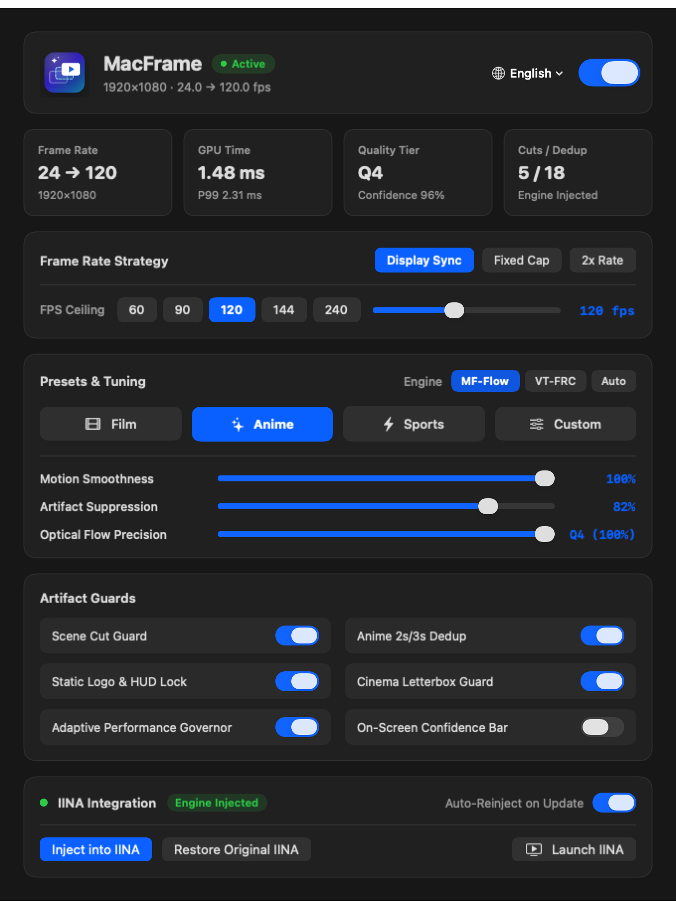
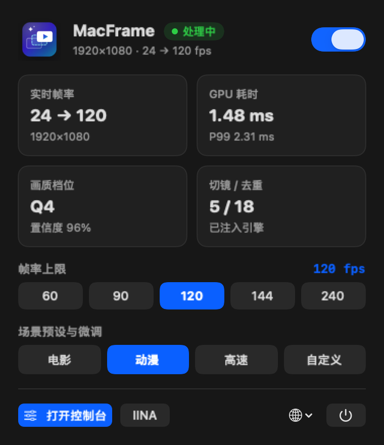

#  MacFrame

[中文文档 (README.zh-CN.md)](./README.zh-CN.md) | [Architecture](./docs/ARCHITECTURE.md) | [Algorithm](./docs/ALGORITHM.md) | [FAQ](./docs/FAQ.md)

**MacFrame** is an open-source real-time video frame interpolation tool for **M-series Macs** and **IINA**.

Built natively on Metal and VideoToolbox, it requires no Python or VapourSynth setup and preserves IINA's hardware decoding pipeline. Once installed, standard IINA playback is interpolated in real time on the GPU, with a standalone `MacFrame.app` and menu bar dashboard for live control.

  
  

---

## Quick Start

### 1. Install
1. Download the latest `MacFrame-v0.2.0-macos.zip` from [Releases](https://github.com/pseudoomer/MacFrame/releases) and extract it.
2. Double-click **`Install MacFrame.command`**.
   - The installer injects the engine into `/Applications/IINA.app` and places the control app in `/Applications/MacFrame.app`.
   - A lightweight background agent automatically re-applies the injection whenever IINA updates.

> To build and install from source instead, run `./scripts/build-engine.sh && ./installer/macframe-install.sh /Applications/IINA.app`.

### 2. Use
- Open any video in **IINA**; frame interpolation engages automatically.
- Use the menu bar icon or **`MacFrame.app`** to adjust settings:
  - **Master Switch**: Turning off interpolation immediately restores IINA's original playback settings.
  - **Frame Rate Ceiling**: Select `60 / 90 / 120 / 144 / 240 fps` presets or set a custom limit.
  - **Scene Presets & Tuning**: Switch between **Film / Anime / Sports / Custom**, or adjust motion smoothness and artifact suppression in real time without interrupting playback.

### 3. Uninstall
Double-click **`Uninstall MacFrame.command`**, or click **Restore Original IINA** in `MacFrame.app`, to restore IINA to its original binary and code signature.

---

## Key Features

MacFrame combines a zero-copy GPU pipeline with dedicated guards against common frame interpolation artifacts:

| Feature | Description |
|---|---|
| **Zero-Copy GPU Pipeline** | Runs Metal optical flow directly on hardware-decoded frames without CPU memory copy-back. |
| **Halo Suppression** | Checks forward-backward flow consistency to mask occluded backgrounds around moving objects. |
| **Scene-Cut Guard** | Detects camera cuts and flashes, falling back to clean source frames across scene boundaries. |
| **Anime Dedup & Line Guard** | Reconstructs duplicated 2s/3s animation frames onto a uniform timeline while preventing double lines. |
| **Static Logo & HUD Lock** | Locks stationary channel logos, scoreboards, and burned-in subtitles against background pull. |
| **Letterbox Protection** | Detects cinema black bars and clamps motion vectors to keep borders clean and straight. |
| **Adaptive Governor** | Monitors GPU frame time and scales search precision (`Q4..Q0`) under load to prevent dropped frames. |

---

## Benchmarks (Apple M4 · 1080p)

| Test Case | Linear Blend | Apple VT-FRC | **MacFrame MF-Flow** |
|---|---|---|---|
| **Sub-Pixel Pan (PSNR / SSIM)** | 44.79 dB / 0.9968 | 54.74 dB / 0.9990 | **56.46 dB / 0.9992** |
| **Occlusion + Static Logo (PSNR)** | 31.20 dB | 48.10 dB | **55.65 dB** |
| **Real Video Held-Out (*Big Buck Bunny*)** | 44.98 dB / 0.9866 | 47.15 dB / 0.9868 | **47.72 dB / 0.9869** |
| **1080p 24 → 120fps Throughput** | >1000 fps | ~105 fps | **468 fps (~2.5 ms/frame)** |

---

## License

Released under the **GPL-3.0-or-later** license. See [LICENSE](./LICENSE).
