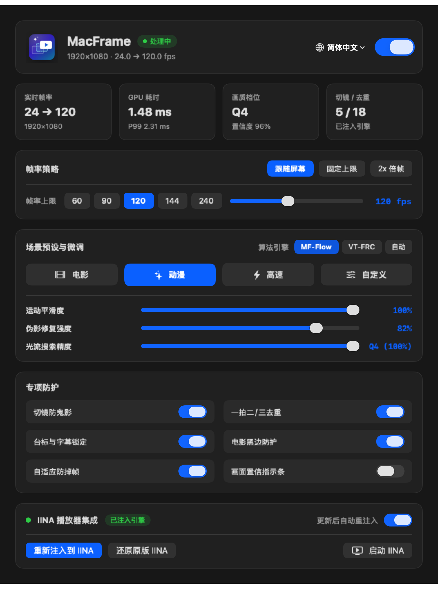
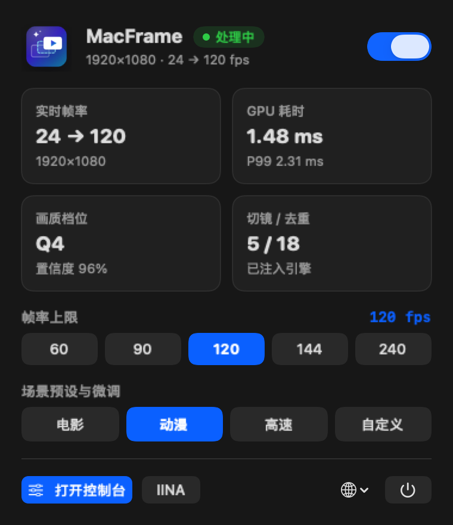

#  MacFrame

[English](./README.md) | [架构设计](./docs/ARCHITECTURE.md) | [算法说明](./docs/ALGORITHM.md) | [常见问题](./docs/FAQ.md)

**MacFrame** 是面向 **Mac M 系列芯片** 与 **IINA** 播放器的开源实时视频补帧工具。

它直接基于 macOS 原生 Metal 与 VideoToolbox 运行，无需配置 Python 或 VapourSynth，也不会破坏 IINA 的硬件解码。安装后即可在原版 IINA 中实现高帧率实时播放，并通过独立的 `MacFrame.app` 或菜单栏面板随时开关与调节。

  
  

---

## 快速安装与使用

### 1. 安装
1. 前往 [Releases](https://github.com/pseudoomer/MacFrame/releases) 下载最新的 `MacFrame-v0.2.0-macos.zip` 并解压。
2. 双击运行 **`Install MacFrame.command`**。
   - 安装脚本会将补帧引擎注入 `/Applications/IINA.app`，并将控制应用安装至 `/Applications/MacFrame.app`。
   - 同时会启用后台守护服务，在 IINA 版本更新后自动完成重新注入。

> 如需从源码编译安装，可执行 `./scripts/build-engine.sh && ./installer/macframe-install.sh /Applications/IINA.app`。

### 2. 使用
- 打开 **IINA** 播放视频，补帧会自动生效。
- 点击系统菜单栏图标或打开 **`MacFrame.app`** 进行控制：
  - **总开关**：关闭补帧时，IINA 会完全恢复原有的播放器设置。
  - **帧率上限**：支持 `60 / 90 / 120 / 144 / 240 fps` 快捷档位及自定义滑块。
  - **场景预设与微调**：提供 **电影 / 动漫 / 高速 / 自定义** 四种模式。播放过程中调整平滑度或修复强度均可实时生效，画面不会中断或黑屏。

### 3. 卸载
双击 **`Uninstall MacFrame.command`**，或在 `MacFrame.app` 底部点击「还原原版 IINA」，即可将 IINA 完整还原至初始状态与原始签名。

---

## 核心特性

MacFrame 采用全程 GPU 零拷贝管线，并针对传统补帧算法常见的画面缺陷提供了专项防护：

| 功能特性 | 说明 |
|---|---|
| **原生零拷贝管线** | 直接在硬件解码帧上执行 Metal 光流计算与合成，无需 CPU 内存回传，兼顾低延迟与低功耗。 |
| **边缘光晕抑制** | 通过双向光流一致性校验识别遮挡区域，避免运动前景边缘产生半透明伪影。 |
| **切镜防残影** | 自动检测镜头切换与画面闪白，在切镜边界直接回退至原始帧。 |
| **动漫去重与护线** | 自动识别动画中的重复帧（一拍二、一拍三）并均匀重建时间轴，同时防止线稿重影。 |
| **台标与字幕锁定** | 自动固定画面中静止的台标、比分牌与内嵌字幕，防止被快速移动的背景拉扯变形。 |
| **电影黑边保护** | 自动检测宽银幕上下黑边，限制越界运动矢量，保持边缘平直干净。 |
| **自适应防掉帧** | 实时监测 GPU 帧耗时，高负载下自动平滑调整计算档位（`Q4..Q0`），保障音画同步。 |

---

## 性能参考（M4 · 1080p）

| 测试项 | 线性混合 | Apple VT-FRC | **MacFrame MF-Flow** |
|---|---|---|---|
| **亚像素平移画质 (PSNR / SSIM)** | 44.79 dB / 0.9968 | 54.74 dB / 0.9990 | **56.46 dB / 0.9992** |
| **遮挡与静止台标区域 (PSNR)** | 31.20 dB | 48.10 dB | **55.65 dB** |
| **真实视频抽帧还原 (*Big Buck Bunny*)** | 44.98 dB / 0.9866 | 47.15 dB / 0.9868 | **47.72 dB / 0.9869** |
| **24 → 120fps 实时合成速度** | >1000 fps | ~105 fps | **468 fps（约 2.5 ms/帧）** |

---

## 开源许可

本项目采用 **GPL-3.0-or-later** 许可证开源，详见 [LICENSE](./LICENSE)。
